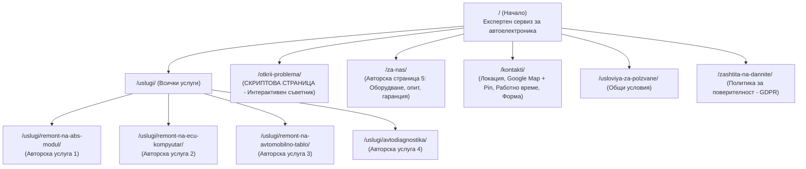

# Стратегически план за сайта AutoElektronik & Покриване на 30-те SEO изисквания

> [!IMPORTANT]
> Този план съчетава най-добрите UX идеи от твоя Figma проект с безупречно покриване на всички 30 университетски изисквания (CSCB700) и подготовка за реален бизнес сервиз след дипломирането.

---

## 1. Концепция и позициониране на сайта

* **Бранд:** **AutoElektronik** (Специализиран сервиз и лаборатория за автомобилна електроника)
* **Позициониране:** Експертен, доверен сервизен център, който решава сложни електронни проблеми (ABS, ECU, километражни табла), без да изисква от клиента скъпа смяна на модула с чисто нов.
* **Целева аудитория:**
  1. *Собственици на автомобили с внезапно светнали контролни лампи/симптоми*, които не знаят техническия термин на повредата.
  2. *Шофьори, търсещи конкретна специализирана услуга* (напр. „ремонт на ABS помпа ATE Teves“).
  3. *Автосервизи и механици*, които изпращат демонтирани модули по куриер за рециклиране и софтуерно клониране.

---

## 2. Какво взаимстваме от Figma проекта

От извлечените от нас файлове от Figma, вземаме най-силните идеи, без да се ограничаваме излишно:

1. **Диагностичния съветник (User Flow):**
   * Във Figma имаш гениална UX пътека: *„Не знам какъв е проблемът“ → стъпков въпросник (симптом + марка) → ориентировъчен резултат → бутон за контакт*.
   * Това директно става сърцето на нашата **Скриптова страница** (Изискване №1).
2. **Цветова палитра и идентичност:**
   * **Основен цвят:** Технологичен петролен тюркоаз (`#0F766E` / `teal-700`) — създава асоциация за прецизност, електроника и експертност.
   * **Второстепенен акцент:** Неутрален шистов графит (`#111827`, `#334155`) и светъл ментов фон (`#F0FDFA`).
3. **Блок-схемата и картата на сайта:**
   * Структурата от твоята страница `03 User Journey & Sitemap` се използва за основа на семантичната йерархия на сайта.

---

## 3. Информационна архитектура (Страници и съдържание)

За да надхвърлим изискването за минимум 5 страници с авторски текст, сайтът ще се състои от **8 основни страници** + задължителните правни документи:

---

## 4. Пълна матрица за покриване на 30-те изисквания

| № | Изискване по конспект | Конкретно техническо решение в нашия сайт |
|:---:|:---|:---|
| **1** | **Поне 1 скриптова страница** | Страницата `/otkrii-problema/` с интерактивен JavaScript въпросник. Потребителят избира симптоми (напр. „педалът рита“, „светят ABS и ESP“), скриптът филтрира дърво от логика и извежда вероятния дефект, ориентировъчна цена и CTA бутон. |
| **2** | **Валиден HTML код** | Astro компилира до чист HTML5. Ще прекараме сайта през W3C Validator с 0 грешки и 0 предупреждения. |
| **3** | **Домейн** | Ще изберем целеви домейн с ключова дума преди финалното предаване (напр. `autoelektronik-service.bg` или `.com`). |
| **4** | **Хостинг** | Cloudflare Pages (безплатен, ултра-бърз global CDN с автоматичен SSL). |
| **5a** | **XML Sitemap** | Стандартен `sitemap-index.xml` и `sitemap-0.xml` със списък на всички публични URL адреси, canonical и дати. |
| **5b** | **XML Imagemap** | `image-sitemap.xml`, съдържащ всички снимки с техните заглавия, описания и URL. |
| **5c** | **XML Videomap** | `video-sitemap.xml`, съдържащ реално авторско сервизно видео (напр. „Диагностика и разпояване на ABS платка“) с thumbnail, продължителност и описание. |
| **6** | **Поне 5 страници с авторски текст** | Покриваме **6 авторски страници**: Начало, Ремонт на ABS, Ремонт на ECU, Ремонт на табла, Автодиагностика, За нас. |
| **7** | **Без плагиатство** | Всички текстове ще бъдат написани оригинално, със специфична сервизна терминология на български език. |
| **8** | **Дължина на съдържанието** | Всяка услуга ще има между 450 и 800 думи експертен текст (симптоми, причини за дефект, етапи на ремонт, гаранция). |
| **9** | **Поне 8 изображения** | Ще включим 10-12 тематични качествени снимки (сервизна база, микроскопско запояване, OBD диагностика, компоненти). |
| **10** | **Изображения с width и height** | Използва се Astro `<Image width={...} height={...} />` — гарантира, че браузърът знае точните пиксели и няма Cumulative Layout Shift (CLS). |
| **11** | **Всички изображения с alt** | 100% от снимките имат смислени, наситени с ключови думи `alt` атрибути на български. |
| **12** | **Всички линкове с title атрибут** | Нашето навигационно меню, бутони и вътрешни линкове ще имат изричен `title="..."` атрибут в HTML кода. |
| **13** | **Списъци (номерирани/неномерирани + меню)** | Менюто в хедъра и футъра ще бъде семантичен `<nav><ul><li>...</li></ul></nav>`. В текстовете на услугите ще има подредени стъпки на ремонт. |
| **14** | **Responsive дизайн** | Mobile-first адаптивен дизайн с Tailwind CSS (тестван за смартфон, таблет и десктоп). |
| **15** | **Поне 1 изходяща връзка** | Експертни препратки към официални технически източници (напр. Bosch Mobility Solutions, ISO/SAE стандарти или AutoData). |
| **16** | **Поне 1 входяща връзка** | Линк от външен реален сайт (напр. профил в GitHub, портфолио в Behance, или локална директория). |
| **17** | **Вътрешни връзки между страниците** | Стратегически контент-линкове: от ABS страницата към диагностиката; от диагностичния съветник към конкретната услуга; breadcrumbs. |
| **18** | **Четими URL адреси** | Кратки, семантични slugs на латиница: `/uslugi/remont-na-abs-modul/`. |
| **19** | **Ключови думи в URL** | Всеки slug съдържа фокусната фраза на услугата. |
| **20** | **Ключови думи в домейна** | Домейнът ще съдържа `autoelektronik` или `remont-avto`. |
| **21** | **Ключови думи в заглавия H1...H6** | Строга йерархия: точно един `<h1>` на страница с главната ключова фраза, `<h2>` за симптоми и етапи, `<h3>` за детайли. |
| **22** | **Условия за ползване и Защита на данните** | Две отделни легални страници във футъра (`/usloviya-za-polzvane/` и `/zashtita-na-dannite/`) по стандартите на ЕС/GDPR. |
| **23** | **Google Map + pin** | Вградена интерактивна Google карта в страницата `/kontakti/` с точен сервизен пин. |
| **24** | **Facebook Open Graph meta tags** | `og:title`, `og:description`, `og:image`, `og:url`, `og:type` на всяка отделна страница. |
| **25** | **Breadcrumbs** | Семантична „трохична навигация“ в горната част на страниците за услуги (напр. *Начало → Услуги → Ремонт на ABS*), придружена от Schema.org JSON-LD. |
| **26** | **Google Search Console & Google Analytics** | Интегрирани GA4 таг (Measurement ID) и верификационен мета таг за Google Search Console. |
| **27** | **Поне 5 ключови думи за всяка страница + мета** | Семантично ядро: всяка страница ще има дефинирани 5 таргетирани фрази и уникален meta description (150-160 символа). |
| **28** | **Попълнена таблица за оптимизация** | Ще изготвим официалната университетска SEO таблица (URL, Title, Description, H1, 5 Ключови думи, Alt текст, Вътрешни линкове). |
| **29** | **Документация с измервания и бързина** | Доклад с тестове от Google PageSpeed Insights (с целеви резултат 95-100/100 на мобилни и десктоп), GTmetrix и W3C валидация. |
| **30** | **PowerPoint презентация** | Структурирана финална презентация, представяща проекта, архитектурата, SEO резултатите и метриките. |

---

## 5. Как това завършва и Минипроекта

Минипроектът изисква:
1. **Планиране на собствен сайт:** Вече имаме концепцията, целите, целевата аудитория, категориите и готовата блок-схема от Figma.
2. **Конкурентен анализ:** В твоя Word документ вече има 3 конкурента (`avto-elektronchik.bg`, `softelectronic.com`, `avtodiagnostika.bg`). Ще го актуализираме през 5-те перспективи (UX, линк билдинг, социални медии, съдържание, техническа част).
3. **Презентация за минипроекта:** Ще подготвим слайдовете въз основа на горните две точки.
