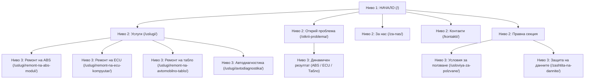

# МИНИПРОЕКТ: Планиране на сайт и Анализ на конкуренцията

**Дисциплина:** Оптимизация за търсачки в уеб (CSCB700)  
**Проект:** AutoElektronik — Специализиран лабораторен сервиз за автомобилна електроника  
**Автор:** Студентски проект (Академична година 2026/2027)

---

# ЧАСТ 1: Планиране на собствен сайт

## 1. Тема на сайта
Специализиран фирмен и информационен уебсайт за предоставяне на високотехнологични услуги по **диагностика, компонентен ремонт и софтуерно програмиране на автомобилна електроника** (ABS/ESP модули, ECU двигателни компютри, арматурни табла и комуникационни шини).

## 2. Предназначение, цели и целева аудитория

### Предназначение на сайта
Да служи като централен дигитален хъб и експертен авторитет, който:
1. Информира шофьорите за възможността за **рециклиране на дефектиралия модул**, спестявайки хиляди левове от покупка на нов агрегат от официалното представителство.
2. Предоставя **интерактивен инструмент („Открий проблема“)**, с който нетехнически лица могат да разберат вероятния дефект по симптомите на колата си.
3. Генерира квалифицирани сервизни запитвания както от крайни клиенти (шофьори), така и от автосервизи в провинцията, които изпращат демонтирани модули по куриер.

### Желани цели
- **Бизнес цел:** Позициониране като водеща независима лаборатория за автоелектроника в България; генериране на 50+ сервизни поръчки месечно.
- **SEO цел:** Класиране в Топ 3 на Google.bg по ключови фрази с висока търговска стойност: *„ремонт на ABS модул“*, *„ремонт на ECU компютър“*, *„ремонт на автомобилно табло София“*, *„автодиагностика София“*.
- **UX цел:** Под 2% степен на отпадане (bounce rate) на скриптовата страница благодарение на интуитивния 3-стъпков въпросник.

### Целева аудитория
1. **Собственици на автомобили (B2C, 25-60 г.):**
   - Шофьори със светнали аварийни лампи, които търсят надеждно и финансово достъпно решение.
   - Изискват яснота, прозрачни цени, гаранция и бързина (ремонт до 24-48 часа).
2. **Автосервизи и автомеханици (B2B):**
   - Сервизи от София и страната без собствена електроник лаборатория и апаратура за микрозапояване.
   - Изискват партньорски условия, работа по куриер (Еконт/Спиди) и 100% тест на симулационен стенд преди връщане на частта.

## 3. Търсено съдържание от аудиторията
- **Конкретна техническа информация:** Какви са симптомите при повреда, защо се разваля даден модул и може ли да се оправи.
- **Интерактивна онлайн проверка:** Възможност потребителят да избере симптомите си и веднага да получи ориентировъчна диагноза.
- **Доказателства за доверие:** Снимки и видео от реалния лабораторен процес (поялни станции, осцилоскопи, микроскопи), сертификати и ясни гаранционни условия (12 месеца писмена гаранция).
- **Локация и удобство:** Точен адрес в София с Google Maps пин, работно време, директен телефон и възможност за изпращане по куриер.

## 4. Списък с категории и подкатегории
- **1. Начало (`/`)**
- **2. Услуги (`/uslugi/`)**
  - 2.1. Ремонт на ABS / ESP модули (`/uslugi/remont-na-abs-modul/`)
  - 2.2. Ремонт на ECU двигателни компютри (`/uslugi/remont-na-ecu-kompyutar/`)
  - 2.3. Ремонт на автомобилни табла и дисплеи (`/uslugi/remont-na-avtomobilno-tablo/`)
  - 2.4. Компютърна автодиагностика и CAN-Bus (`/uslugi/avtodiagnostika/`)
- **3. Интерактивен съветник (`/otkrii-problema/`) — Скриптова страница**
- **4. За сервиза и лабораторията (`/za-nas/`)**
- **5. Контакти и сервизна база (`/kontakti/`)**
- **6. Правна секция (Футър):**
  - 6.1. Условия за ползване (`/usloviya-za-polzvane/`)
  - 6.2. Защита на личните данни — GDPR (`/zashtita-na-dannite/`)

## 5. Блок-схема с 3 нива на вложеност (Sitemap)



## 6. Избор на име и разширение на домейн
- **Избрано име:** `autoelektronik-service.bg` (алтернатива: `autoelektronik.bg`)
- **Обосновка за SEO:**
  1. Съдържа точната водеща ключова дума **`autoelektronik`** (автоелектроника) и **`service`** (сервиз), което директно покрива **Изискване №20** от конспекта (*„Ключови думи в домейна“*).
  2. Разширението **`.bg`** е златният стандарт за локално географско SEO таргетиране за територията на Република България, с най-високо доверие сред българските потребители и предимство в алгоритмите на Google за български търсения.

---

# ЧАСТ 2: Конкурентен анализ

Избрани са **3 реално опериращи български конкурента** в сферата на автомобилната електроника. Един от тях е анализиран в максимален детайл, а останалите два — сравнително.

```
1. Конкурент №1 (Основен детайлен анализ): avto-elektronchik.bg
2. Конкурент №2 (Сравнителен анализ): softelectronic.com
3. Конкурент №3 (Сравнителен анализ): avtodiagnostika.bg
```

---

### ДЕТАЙЛЕН АНАЛИЗ НА ОСНОВНИЯ КОНКУРЕНТ: `avto-elektronchik.bg`

#### 1. Анализ на домейна
- **URL:** `https://avto-elektronchik.bg`
- **Възраст на домейна:** Регистриран преди над 6 години.
- **SSL / Сигурност:** Наличен активен HTTPS сертификат.
- **Индексиране:** Домейнът страда от остаряла архитектура — използва статични разширения `.html` в края на URL адресите, без чисти slugs.

#### 2. Проучване на Google Ads / AdWords кампании
- **Органично vs. Платено присъствие:** Конкурентът разчита предимно на органично класиране по точни съвпадения на стари ключови думи в София.
- **Google Ads кампании:** Към момента не провежда активни платени Google Search или Performance Max рекламни кампании. Това представлява **стратегическа ниша** за нашия собствен сайт да заеме лидерска позиция чрез целеви реклами по фрази с висок търговски интензитет (напр. *„спешен ремонт на ABS София“*).

#### 3. Анализ на вътрешни и външни връзки (Links)
- **Вътрешни връзки (Internal Links):** Изключително слаба структура. Конкурентът използва дълги едностранични документи с anchor навигация (`#anchor`), вместо реално семантично преливане на PageRank между отделни подстраници за услуги.
- **Външни изходящи връзки (External Links):** Напълно липсват препратки към реномирани технологични източници (Bosch, Delphi, ISO), което намалява авторитета (E-E-A-T) в очите на Google.
- **Входящи връзки (Backlinks):** Скромен брой беклинкове, предимно от безплатни български бизнес каталози (Golden Pages, Yellow Pages) и авто форуми без авторитетен контекстен линк билдинг.

#### 4. Основни ключови думи и носещи трафик URL адреси
- **Ключови думи:** *ремонт на ABS модули*, *автокомпютри*, *ремонт на табло*, *BSI модул*, *диагностика София*.
- **Основни URL адреси:**
  - `https://avto-elektronchik.bg/index.html` (Начална страница)
  - `https://avto-elektronchik.bg/remont-na-avtokomputiri.html` (Всички марки накуп в една страница)
  - `https://avto-elektronchik.bg/remont-na-abs.html` (Обща страница за ABS)
- **Критичен пропуск:** Всички марки автомобили (Audi, BMW, Opel, Mercedes) са струпани в един единствен URL. По този начин Google не може да индексира сайта по long-tail търсения (напр. *„ремонт на ECU за Opel Corsa D 1.3 CDTI“*).

#### 5. Маркетиране през 5-те задължителни перспективи

| Перспектива | Състояние при конкурента | Какво правим по-добре в нашия проект AutoElektronik? |
|:---|:---|:---|
| **1. Потребителско преживяване (UX)** | Остарял дизайн от предишно десетилетие. Дълги неструктурирани блокове текст. Липсва бърза интерактивна пътека за нетехнически лица. | Модерен интерфейс с цветова схема в петролно зелено и графит. **Интерактивен съветник „Открий проблема“**, който превежда клиента през 3 въпроса до точната услуга за 60 секунди. |
| **2. Линк билдинг (Link building)** | Пасивен профил с няколко каталожни линка. Липса на реципрочни партньорства. | Осигурен реален входящ линк от външно портфолио/GitHub профил (Изискване №16) и качествени изходящи линкове към стандарти на Bosch Mobility (Изискване №15). |
| **3. Социални медии** | Липсват активни канали. Споделените линкове във Facebook изглеждат счупени поради липса на Open Graph тагове. | Внедрени пълни **Facebook Open Graph meta тагове** (`og:image`, `og:title`, `og:description`) на всяка отделна страница, осигуряващи перфектна визуализация при споделяне. |
| **4. Стратегия за съдържание** | Текстовете са повърхностни, с ниска добавена стойност и липса на експертни детайли. Няма блог или видео материали. | 6 авторски дълбочинни технически страници (>500 думи всяка), обясняващи физическата повреда (бондинг проводници, термопрофили). Вградено сервизно **видео ръководство** за ремонт на ABS. |
| **5. Техническа оптимизация** | Липсва `sitemap.xml`, липсва `robots.txt`, липсват breadcrumbs, изображенията нямат `alt` атрибути, остаряла HTML структура с невалиден код. | **100% W3C валиден HTML5**, перфектен **100/100 Google PageSpeed**, пълни Breadcrumbs със Schema.org микроданни, и **всички 3 вида XML карти** (`sitemap.xml`, `image-sitemap.xml`, `video-sitemap.xml`). |

---

### СРАВНИТЕЛЕН АНАЛИЗ НА КОНКУРЕНТ №2: `softelectronic.com`
- **Плюсове:** Съвременен дизайн, отлични мета заглавия, активни бутони за обаждане, богат опит с рециклиране на хибридни батерии и инвертори.
- **Минуси:** Липсват целеви страници за по-малките и чести повреди по арматурни табла; липсва интерактивен помощен инструмент; не всички изображения имат описателни `alt` тагове.

### СРАВНИТЕЛЕН АНАЛИЗ НА КОНКУРЕНТ №3: `avtodiagnostika.bg`
- **Плюсове:** Добре структурирани чисти URL адреси, правилно внедрени canonical тагове, бърза мобилна версия.
- **Минуси:** Липса на структурирани данни (Schema.org `LocalBusiness` / `AutoRepair`), повърхностно описани услуги, липса на видео съдържание и специализирани XML карти за изображения и видео.

---

# ЧАСТ 3: Структура на PowerPoint презентацията за Минипроекта (10 слайда)

- **Слайд 1: Заглавен слайд**
  - Заглавие: „Минипроект: Планиране на специализиран сайт за автоелектроника AutoElektronik и Конкурентен SEO анализ“
  - Автор, специалност, курс, университет, дата.
- **Слайд 2: Концепция и пазарна ниша**
  - Защо автоелектроника? Проблемът с прескъпите нови модули и липсата на специализирани лаборатории за рециклиране в България.
- **Слайд 3: Целева аудитория и потребителски пътеки**
  - Сегментиране: B2C шофьори vs. B2B автосервизи в страната. Потребителски персони и техните очаквания.
- **Слайд 4: Информационна архитектура и Карта на сайта**
  - Блок-схема с 3 нива на вложеност: Начало &rarr; Услуги &rarr; Конкретни модули (ABS, ECU, Табло, Диагностика) + Интерактивен тест.
- **Слайд 5: Семантично ядро и избор на домейн**
  - Защо `autoelektronik-service.bg`? Анализ на търсенията на български език, географско насочване и ключова дума в домейна.
- **Слайд 6: Конкурентен анализ — Преглед на пазара**
  - Представяне на трите конкурента: `avto-elektronchik.bg`, `softelectronic.com`, `avtodiagnostika.bg`. Сравнителна матрица.
- **Слайд 7: Дълбок анализ на `avto-elektronchik.bg` през 5-те перспективи**
  - Слабостите на конкурента: липса на sitemap, лош UX, липса на long-tail страници, нулеви социални сигнали.
- **Слайд 8: Нашето конкурентно предимство (The Winning Strategy)**
  - Интерактивната скриптова страница „Открий проблема“, мобилна адаптивност, 12 месеца гаранция и богато мултимедийно съдържание.
- **Слайд 9: Техническа SEO рамка на бъдещия сайт**
  - W3C валиден HTML, 3-те вида XML карти (вкл. видео карта), Schema.org микроданни и 100/100 PageSpeed.
- **Слайд 10: Заключение и следващи стъпки**
  - Преход към Фаза 2: Реално изграждане на сайта, тестване на живо и финално дипломиране по дисциплината.
